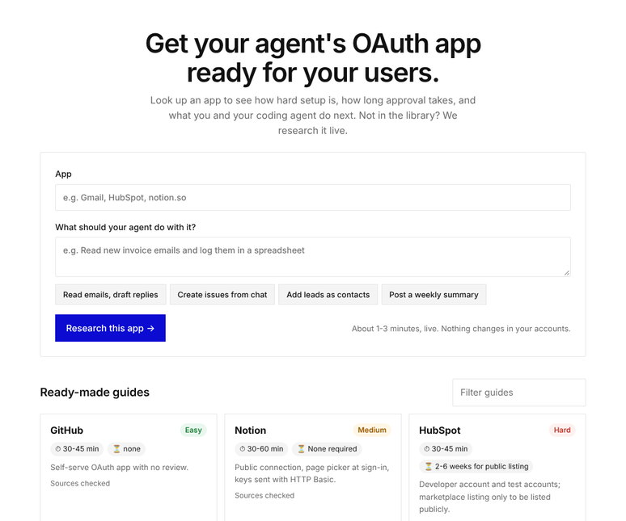
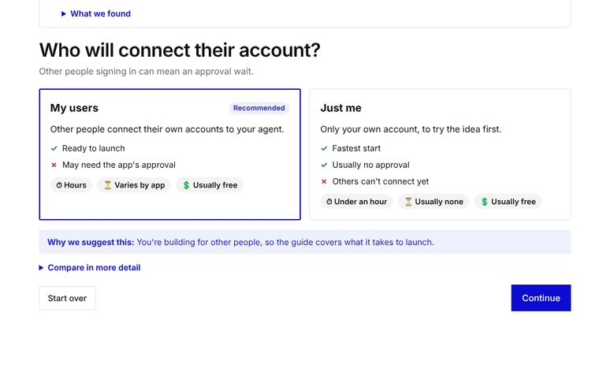
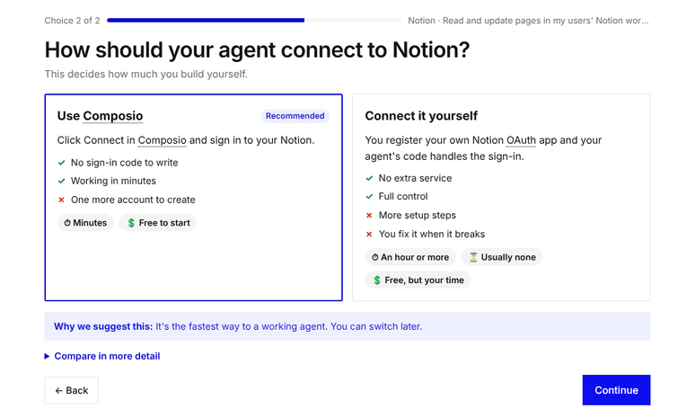
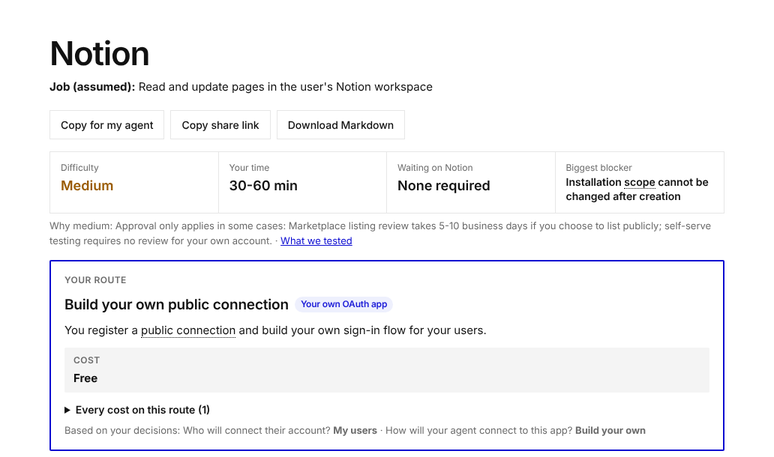
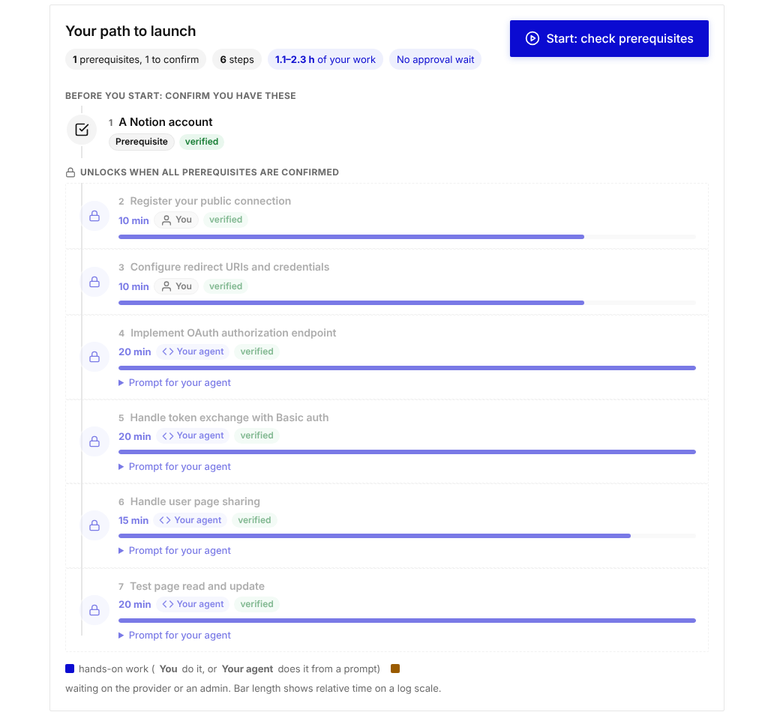
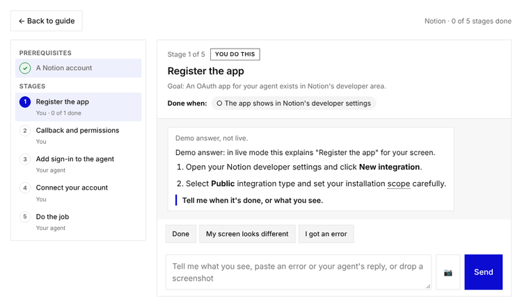
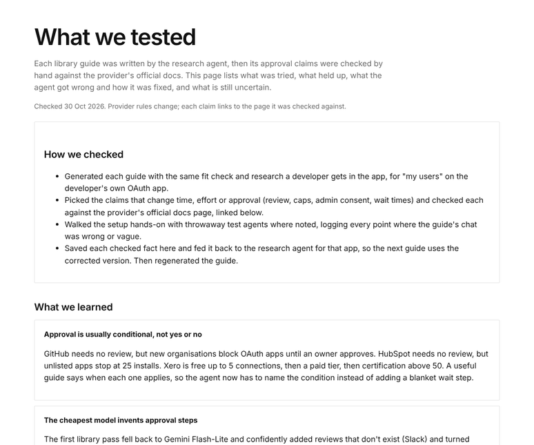

# Agent Connect Guides

Builders want their agent to do a job in someone's Notion, Gmail or HubSpot. To get there, they first have to set up an OAuth app, and sometimes get it approved. This app gets them through that, one stage at a time.

**Who it's for:** builders who make agents with a coding agent such as Claude Code or Cursor. They know what they want the agent to do. They don't know OAuth, and they don't want to piece it together from five docs pages, a review policy and a forum thread.

**What it does:**
- Before you start, it tells you how hard the app is: the difficulty, your time, any approval wait, and the biggest blocker.
- It recommends the fastest route. Often that's Composio, which already has an approved app.
- It walks you through setup one stage at a time. Every step says whether you do it or your coding agent does.

**Try it:** [hosted demo](#) _(link added after deploy)_. Open a ready-made guide, research any app live (1-3 minutes), or read [What we tested](#what-we-tested-and-whats-uncertain).

---

## Walkthrough

### 1. Pick an app

Open one of six ready-made guides, or type any app and what your agent should do with it. Each card shows the difficulty, your time and any approval wait up front.



### 2. Answer two questions

The app first works out what your agent needs to do in that app. Then it asks only what changes the setup. First: who will connect their account?



Second: how should your agent connect? When Composio supports the app, it's recommended. The do-it-yourself route is shown honestly beside it.



### 3. See what you're in for

The guide opens with four facts: difficulty, your time, the wait, and the biggest blocker. Each one comes with the reason behind it.



### 4. See who does what

Every step is marked **You** (clicks in a website) or **Your agent** (code, with a prompt ready to paste into your coding agent). Every claim is labelled verified, inferred or unknown.



### 5. Set it up, one stage at a time

Press Start, and each stage becomes a short chat. Tell it what you see, paste an error, or drop a screenshot. It moves on only when that stage is really done. Stages: register the app, callback and permissions, keys, add sign-in to the agent, connect, do the job, and approval if needed.



_This screenshot was taken in demo mode, so the answer is canned. With a key, the chat answers from live research._

### 6. Check what we tested

One page shows what we tried by hand, which claims we checked against official docs, what the research got wrong, and what's still uncertain.



---

## Key product decisions

### 1. Solve for the job, not for OAuth

The builder's goal is "my agent adds leads to HubSpot", not "I set up OAuth". So the app starts from the job. It works out what the agent needs to do, checks whether Composio already covers it, and recommends the shortest path to a working agent.

- **For the builder:** they get the right route without reading every doc. Often the answer is "skip most of this".
- **For Composio:** it works as inbound marketing. It meets builders at the moment they're stuck, and shows Composio's approved app saving weeks of review.
- **Trade-off:** one extra step before the guide, and a recommendation that could look biased. So the do-it-yourself route is always shown next to Composio, with its real costs.

### 2. Fixed stages, filled in by live research

Every app gets the same stages: register, callback and permissions, keys, add sign-in, connect, do the job, and approval. Live web research fills in the details for that app.

- **For the builder:** a predictable path whatever the app, so nothing gets skipped.
- **For Composio:** one format that scales to 100+ apps. Guides can be compared and checked the same way.
- **Trade-off:** an unusual app may not fit the template perfectly.

### 3. A chat for each stage, not one long guide

A long document assumes two things: the builder follows it exactly, and the research is right. Neither holds. Builders go off track on screens nobody researched, like which app type to pick, which secret to copy, or the page picker at sign-in. Web research is sometimes wrong or out of date. So we stay with the builder at every stage. The chat sees their screen and errors, corrects course, and only moves on when the stage's checklist is met.

- **For the builder:** help at the exact screen where first-timers give up.
- **For Composio:** more builders finish setup, and every stuck moment shows where integrations fail. Errors that builders paste become lessons the research uses next time.
- **Trade-off:** more model calls, so more cost and a few seconds per turn.

### Other decisions

| Decision | Why |
|---|---|
| **You versus your agent** | Console clicks are yours. Code, CLI and API work goes to your coding agent as a ready prompt. The agent never sees secret values. |
| **Composio's managed app as the approval shortcut** | Users sign in through an app the provider already approved, which skips weeks of review. We ask whose name should show on the sign-in screen only when other people will sign in. |
| **"My users" is the default** | Approval for other people is the hard part. "Just me" exists for trying an idea first. |
| **Difficulty rates the provider, not the code** | OAuth code is the same everywhere, and a coding agent writes it fast. Hard means a wait you can't speed up: a review, certification, a user cap or admin consent. |
| **Honest about evidence** | Claims are labelled, every link is tested before saving, and our own mistakes are published. A guide that's confidently wrong costs a builder weeks. |
| **Six deep apps, not 100 shallow ones** | Each library app was checked by hand, and they were picked for different setup challenges. The same script builds more. |
| **No accounts** | A guide is a link you can share. Progress is saved in your browser. |

---

## What we tested and what's uncertain

- **Real sign-in:** a test agent completed Notion's OAuth sign-in and then read a real page.
- **Stage chats:** we walked them against Notion and GitHub test agents, logged every friction, and turned the worst ones into rules.
- **Claims checked against official docs:** the approval claims for all six library apps (GitHub, Notion, HubSpot, Slack, Xero, Gmail).
- **What the research got wrong, and the fixes:** a weaker fallback model invented reviews, and difficulty was being rated on code. Both are fixed.
- **Still uncertain:** most review wait times, because providers rarely publish them. Approval for other people's accounts was checked against docs, not tried.

The full list, with sources, is on the What we tested page (`/evidence`).

## Limitations

- The research reads docs. It doesn't log in to provider consoles, so a changed screen can still surprise it. The stage chat is the safety net.
- On the hosted copy, live research is capped per day. Generated guides vanish when the server restarts. The library always works.
- Reading screenshots needs a Gemini key. Without one, describe the screen in words.

## Run it locally

Requires Node 22+.

```bash
npm install
cp .env.example .env   # add PARALLEL_API_KEY
npm start              # http://localhost:3000
```

With no key, it runs in demo mode with canned answers.

**More detail:** see [docs/HOW-IT-WORKS.md](docs/HOW-IT-WORKS.md) for the architecture, models, API routes and repo layout.
